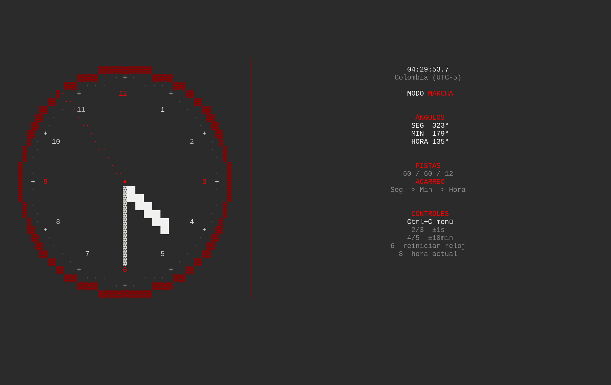
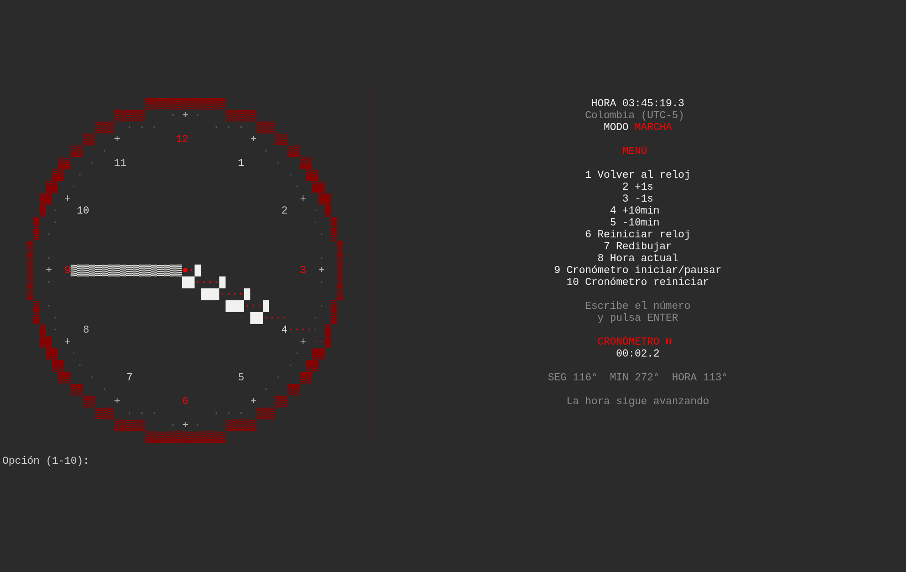

# Reloj Analógico Mecánico

## Código

El proyecto está hecho únicamente en Python. Para no dejar todo en un solo archivo, se divide en módulos y los únicos imports permitidos son los archivos locales del proyecto. No se usan librerías externas.

Archivos:

- `dial_mark.py`
- `circular_track.py`
- `hand.py`
- `gear_train.py`
- `mechanical_clock.py`
- `clock_view.py`
- `main.py`

## Capturas

Pantalla principal:



Menú:



## Ejecución local

```text
./entrypoint.sh
```

`entrypoint.sh` es solo el lanzador local de la terminal; no hay Docker ni despliegue.

Al abrir, el reloj inicia en marcha automática en hora Colombia (UTC-5). Las manecillas giran en una terminal a pantalla completa. La hora se muestra con décimas. El cronómetro no arranca automáticamente: se inicia desde el menú y se muestra únicamente allí. La esfera tiene números del 1 al 12. En pantallas anchas el reloj queda a la izquierda y la información a la derecha; en pantallas pequeñas, la información va al pie.

## Controles

- `Ctrl+C`: abrir o cerrar el menú, sin pausar el reloj.
- `1`: volver al reloj.
- `2`: avanzar 1 segundo.
- `3`: retroceder 1 segundo.
- `4`: avanzar 10 minutos.
- `5`: retroceder 10 minutos.
- `6`: reiniciar a `12:00:00`.
- `7`: redibujar.
- `8`: volver a la hora actual.
- `9`: iniciar/pausar el cronómetro.
- `0`: reiniciar el cronómetro.

El reloj sigue avanzando mientras el menú está abierto. El cronómetro se muestra y controla en el menú, no en la pantalla principal. Para terminar, cierra la pestaña o la terminal.

Solo se acepta un dígito del 0 al 9. No se aceptan letras ni varios números. Cualquier otra entrada muestra un aviso. Haz clic dentro de la terminal para que el teclado funcione.
